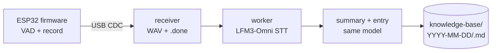

# Repartee

USB CDC receiver for the ESP32 conversation recorder. It reads the firmware's
START/AUDIO/END records from the board's USB serial console and writes one 16-bit
PCM WAV per utterance into `data/recordings/`. The bigger-device stage then
transcribes and summarizes a finished WAV with
[LFM3-Omni-2B](https://huggingface.co/LiquidAI/LFM3-Omni-2B) and writes one
Markdown entry per conversation into `knowledge-base/`. The firmware is
unchanged (it lives in
[`RakiDelmoro/conversation-recorder`](https://github.com/RakiDelmoro/conversation-recorder)).

The 2.17 B model does **not** run on the ESP32: 4.3 GB of fp16 weights versus
8 MB of PSRAM. The device keeps the low-power job — VAD and recording — and the
bigger device runs the model.



## Storage

| file | meaning |
|---|---|
| `data/recordings/YYYYMMDD-HHMMSS-<device>.wav` | one utterance |
| `data/recordings/*.wav.done` | written after END fixes the WAV; the worker claims only these |
| `data/recordings/*.wav.error` | failed job; the worker skips it until `process --force` |
| `knowledge-base/YYYY-MM-DD/<id>.md` | one conversation: YAML frontmatter + summary + transcript |

The WAV appears at START and is playable while it grows: its RIFF/data sizes are
refreshed every 5 s and fixed on END, so you can listen to a recording before the
device closes the session.

`<device>` is the board id from START, sanitised to `[A-Za-z0-9]`; the timestamp
is the receiver clock at START. Filenames are monotonic within a second, so two
utterances never collide, and an existing file is never overwritten.

## Wire protocol (v1, little-endian)

| record | struct | size | fields |
|---|---|---|---|
| START `1` | `<IIIHHQQ16s` | 48 B | session_id, first_sample, rate, channels, bits, start_unix_ms, uptime_ms, device_id[16] |
| AUDIO `2` | raw PCM | ≤ 6400 B | 16-bit samples as declared in START |
| END `3` | `<IIB3xI` | 16 B | session_id, total_samples, reason, crc |
| ACK `0x81` | `<II` | 8 B | session_id, acked_samples (+ final flag) |

Every AUDIO record is ACKed with the running sample count so the firmware can free
its queue; after a link drop the device sends START with `first_sample` and the
receiver resumes at that offset. The ESP-IDF console shares the port, so the
framer scans for `CREC` and skips log text.

## Run

1. **Attach the board to the Docker host.** Windows, PowerShell as Administrator:

   ```powershell
   winget install usbipd
   usbipd list                     # note the board's BUSID, e.g. 2-1
   usbipd bind --busid 2-1         # once per device
   usbipd attach --wsl --busid 2-1 # after every replug; --auto-attach keeps it bound
   ```

2. **Check the container sees the node.** It must exist before the container is
   created, because `runArgs` maps it in:

   ```bash
   ls -l /dev/ttyACM0
   ```

   Docker Desktop's engine runs in its own VM and cannot see a device attached to
   the WSL distro. Then either run Docker Engine inside the WSL distro (so
   `--device` works), or keep Desktop and run the receiver on the host:
   `repartee receiver --serial /dev/ttyACM0` in WSL, or `--serial COM3` on Windows
   (needs `pip install pyserial`).

3. **Install once inside the container.** No rebuild needed; the image ships the
   Python toolchain, and an older container gets it from the first line:

   ```bash
   command -v python3 >/dev/null || { apt-get update && apt-get install -y --no-install-recommends python3 python3-venv; }
   test -x .venv/bin/python || python3 -m venv .venv
   .venv/bin/pip install -e '.[receiver]'
   ```

4. **Free the port.** Close `espflash monitor`; only one process may own the tty:

   ```bash
   fuser -v /dev/ttyACM0
   ```

5. **Start the receiver:**

   ```bash
   .venv/bin/repartee receiver            # or: .venv/bin/python -m app receiver
   # logs: "serial: /dev/ttyACM0 open" then one line per finalized recording
   ```

   A foreground run dies with its terminal. To keep it alive:
   `mkdir -p data && nohup .venv/bin/repartee receiver > data/receiver.log 2>&1 &`.

6. **Verify:** speak, then `ls -l data/recordings` — each utterance shows up as
   one `*.wav`, playable immediately and finalized on END. Unplug/replug needs no restart: the
   receiver reopens the port and the firmware resumes from the last ACK.

## Bigger device: speech to text

```bash
.venv/bin/pip install -e '.[bigger]'

# A local checkpoint avoids the 4.3 GB Hugging Face download.
REPARTEE_STT_MODEL=/root/.cache/repartee/LFM3-Omni-2B \
  .venv/bin/repartee transcribe data/recordings/20261128-101500-rep01.wav

# JSON with chunk boundaries and timings; --out writes a file.
REPARTEE_STT_MODEL=/root/.cache/repartee/LFM3-Omni-2B \
  .venv/bin/repartee transcribe recording.wav --json --out recording.transcript.json
```

The WAV is downmixed and resampled to 16 kHz mono. It is split into chunks of at
most 60 s; each boundary is moved back to the last pause of at least 250 ms in
the final 20 % of the window, with a hard cut at 60 s when the speech never
pauses. The model's encoder is quadratic in audio length, so 60 s is the ceiling
that fits an 8 GB GPU. An empty result is retried once as two half chunks.

Measured on a Quadro RTX 4000 (8 GB), fp16: 6.6 s to load the model and ~30 s to
generate the transcript of a 60 s clip when the host is idle. The same run took
~100 s while a large filesystem delete was competing for CPU and disk, so treat
the idle number as the machine's ceiling. ASR is `Perform ASR in English.` with
`generation_mode="text"`; the model reads about 13 audio tokens per second.

The test sample is `samples/open-yap-1k/conv_d4005da6db98-60s.wav` — 60 s of a
two-speaker Open Yap 1K conversation (`conv_d4005da6db98`, start 75 s), 16 kHz
mono, CC-BY-4.0. Its `.json` sidecar records the source and excerpt offset.
`samples/` is gitignored; the sidecar is the provenance record.

### Noise

Same 60 s clip, real noise loops mixed at controlled SNR. WER is word-level
**against the clean LFM3 transcript**, not ground truth; it measures degradation.

| noise | SNR | WER vs clean |
|---|---:|---:|
| vacuum | 10 dB | 4 % |
| vacuum | 5 dB | 7 % |
| engine | 10 dB | 4 % |
| engine | 5 dB | 5 % |
| engine | 0 dB | 7 % |
| rain | 10 dB | 14 % |
| cafe/room ambience | 10 dB | 2 % |

Steady vacuum/engine noise is tolerated; rain is the worst real noise tested.
Noise-only input is **not** empty — the model emitted a short “Thank you.” So the
device VAD must gate, and the pipeline should reject very short transcripts.

## Summarization and the knowledge-base folder

LFM3 writes the summary; deterministic code owns the file path and the atomic
write. A model error can produce a bad summary, but it cannot corrupt the folder
or move a conversation.

```bash
# One file, end to end. The model loads, transcribes, summarizes, writes one .md.
REPARTEE_STT_MODEL=/root/.cache/repartee/LFM3-Omni-2B \
  .venv/bin/repartee process data/recordings/20261128-101500-rep01.wav

# Long-lived worker: hold the model, poll data/recordings for *.wav.done.
REPARTEE_STT_MODEL=/root/.cache/repartee/LFM3-Omni-2B .venv/bin/repartee worker
REPARTEE_STT_MODEL=/root/.cache/repartee/LFM3-Omni-2B .venv/bin/repartee worker --once

# Query the folder. There is no database and no index; these walk the Markdown.
.venv/bin/repartee conversations
.venv/bin/repartee search "visa paperwork"
.venv/bin/repartee show 20261128-101500-rep01
```

### Autonomous operation

The receiver and the worker are two processes. The receiver does **not** spawn
the worker. Start both once and no human step is needed per recording:

```bash
mkdir -p data
nohup .venv/bin/repartee receiver > data/receiver.log 2>&1 &
nohup env REPARTEE_STT_MODEL=/root/.cache/repartee/LFM3-Omni-2B \
  .venv/bin/repartee worker > data/worker.log 2>&1 &
```

The handshake is the `.done` sidecar:

1. Receiver gets END, fixes the RIFF sizes, closes the WAV, writes `.wav.done`.
2. Worker polls `data/recordings` every 2 s and claims only `.wav.done` files.
3. Worker runs STT, then summary, then atomically writes the Markdown entry.
4. Existing ids are skipped; `.error` files are quarantined until
   `process --force`; a worker restart catches up on everything still pending.

With only the receiver running, WAVs accumulate and nothing is transcribed. With
both running, the flow is autonomous. The worker keeps the model loaded after
the first job; the first job pays the cold start.

#### Keeping the processes up

`nohup ... &` survives closing the terminal, not a crash, OOM, `Ctrl-C`, or a
container/reboot. The worker is an ordinary foreground process; nothing starts
or restarts it for you. For development, use the small supervisor:

```bash
nohup env REPARTEE_STT_MODEL=/root/.cache/repartee/LFM3-Omni-2B \
  scripts/supervise.sh > data/supervise.log 2>&1 &
```

It starts both children and restarts either one after 5 s if it exits. It uses
`data/receiver.log` and `data/worker.log`. It does **not** survive a container
stop or a machine reboot. This container has no systemd (`systemctl` is a stub);
on a real Linux host use a systemd unit with `Restart=always`, or run the
container with a restart policy and a process manager inside it.

The worker being down is normal and recoverable: every `.done` file stays on
disk, and a restart drains the backlog. It is not loss-free if the disk fills or
someone deletes the recordings. Check with:

```bash
pgrep -af 'repartee (receiver|worker)'
tail -f data/worker.log
```

Layout:

```text
knowledge-base/
├── README.md
└── 2026-11-28/
    └── 20261128-101500-rep01.md
```

The file is YAML frontmatter plus two sections:

```markdown
---
schema: 1
id: 20261128-101500-rep01
device: rep01
started_at: 2026-11-28T10:15:00
duration_s: 60.0
language: English
model: LFM3-Omni-2B
audio: data/recordings/20261128-101500-rep01.wav
audio_bytes: 1920044
status: summarized
created_at: 2026-11-28T10:16:12+00:00
---

# Summary

Three sentences from LFM3.

# Transcript

The verbatim ASR output.
```

Audio stays in `data/recordings/`; the KB stores its path. `knowledge-base/` is
gitignored. The filename is the WAV stem, so `show` takes `20261128-101500-rep01`,
not `.wav`. A complete file is the idempotence marker: the worker skips an
existing id unless `process --force` is used. Writes go through a temp file and
`os.replace`, so a crash leaves no half-written entry.

`process` pays the model's cold start; `worker` keeps the model loaded and is the
production path (~10 s STT for 60 s audio after warmup, plus summary time). The
summary prompt asks for three sentences. Transcripts over 6,000 characters are
summarized in sentence-aligned chunks and the summaries are summarized once more.

Failure semantics: a failed summary keeps the transcript and writes status
`transcribed`; an empty transcript, or any exception in the job, writes a
`.error` sidecar in `data/recordings` and is left alone. Transcripts under three
words are written with status `short` and are not summarized — that is the guard
for ASR noise hallucinations such as “Thank you.” The explicit `process --force`
retries a quarantined file and replaces the entry.

## Settings

| variable | default | meaning |
|---|---|---|
| `REPARTEE_SERIAL` | `/dev/ttyACM0` | USB CDC device (`COM3` on Windows) |
| `REPARTEE_DATA` | `<cwd>/data` | parent of the recordings folder |
| `REPARTEE_RECORDINGS` | `<data>/recordings` | where WAVs are written |
| `REPARTEE_STT_MODEL` | `LiquidAI/LFM3-Omni-2B` | HF id or local checkpoint |
| `REPARTEE_STT_LANGUAGE` | `English` | ASR language name |
| `REPARTEE_STT_DEVICE` | `auto` | `cuda`, `cpu`, or `auto` |
| `REPARTEE_STT_CHUNK_SECONDS` | `60` | maximum audio per forward pass |
| `REPARTEE_STT_MAX_NEW_TOKENS` | `1024` | generation cap per chunk |
| `REPARTEE_KNOWLEDGE_BASE` | `<cwd>/knowledge-base` | Markdown conversation folder |
| `REPARTEE_SUMMARY` | `1` | set to `0` to store transcripts without summaries |
| `REPARTEE_WORKER_POLL` | `2` | seconds between recording polls |

`--serial` and `--out` override the receiver settings; `--model`,
`--language`, `--chunk-seconds` and `--max-new-tokens` override the STT ones.
`--knowledge-base` selects another folder.

## Deployment

The application is identical in development and production: two processes, one
durable queue (`data/recordings/*.wav.done`), one Markdown folder
(`knowledge-base/`). Only the supervisor differs. The receiver never starts the
worker.

| environment | supervisor | survives a crash | survives reboot |
|---|---|---|---|
| dev container | `scripts/supervise.sh` | yes, 5 s restart | no, unless the container restarts |
| native Linux/WSL | systemd `repartee.target` | yes, `Restart=always` | yes |
| Docker | Compose `restart: unless-stopped` | yes | yes, if Docker starts |

### Where to run what

Run exactly **one** of these. Never run two receivers against the same
`/dev/ttyACM0`, and never run two workers against the same GPU.

| Where | Start command | Lives until |
|---|---|---|
| this dev container | `nohup env REPARTEE_STT_MODEL=... scripts/supervise.sh ... &` | the container stops |
| WSL/Ubuntu host, systemd | `sudo systemctl enable --now repartee.target` | reboot |
| WSL/Ubuntu host, Docker | `docker compose up -d --build` | Docker stops it |

This container has **no systemd** (`systemctl` is a stub) and **no Docker CLI**
(`docker: command not found`), so the systemd and Docker commands must run on
the WSL/Ubuntu host, not inside the container. That host also needs a
host-visible copy of the model; `/root/.cache/repartee/LFM3-Omni-2B` exists
inside this container, not on the host.

### systemd (native Linux, or WSL with systemd)

Use this when the repo runs on a real Linux host. This development container has
no systemd (`systemctl` is a stub here).

```bash
# Service account and directories.
sudo useradd --system --user-group --home /var/lib/repartee --shell /usr/sbin/nologin repartee
sudo usermod -aG dialout,video,render repartee
sudo mkdir -p /opt/repartee /var/lib/repartee /etc/repartee

# Install the application in /opt/repartee (clone or copy this repo there).
cd /opt/repartee
python3 -m venv .venv
.venv/bin/pip install -e '.[bigger]'
sudo chown -R repartee:repartee /opt/repartee /var/lib/repartee

# Configuration and units.
sudo cp deploy/systemd/repartee.env.example /etc/repartee/repartee.env
sudoedit /etc/repartee/repartee.env
sudo cp deploy/systemd/*.service deploy/systemd/*.target /etc/systemd/system/
sudo systemctl daemon-reload
sudo systemctl enable --now repartee.target

systemctl status repartee.target
journalctl -u repartee-receiver -u repartee-worker -f
```

The units in `deploy/systemd/`:

| unit | role |
|---|---|
| `repartee-receiver.service` | owns `/dev/ttyACM0`; `Restart=always`; `dialout` |
| `repartee-worker.service` | owns the GPU/model; `Restart=always`; `video render` |
| `repartee.target` | starts/stops both; `Wants=` both, services are `PartOf=` it |

Notes:

- `StateDirectory=repartee` creates `/var/lib/repartee` for the service user.
  `repartee.env` points `REPARTEE_DATA` and `REPARTEE_KNOWLEDGE_BASE` into it.
- Put the model at `/opt/repartee/models/LFM3-Omni-2B`, or set
  `REPARTEE_STT_MODEL` to any readable checkpoint path. The model directory must
  be readable by `repartee`.
- Serial access comes from the `dialout` group. GPU access comes from `video`
  and `render` on common distributions; if your `/dev/nvidia*` nodes have a
  different group, adjust `SupplementaryGroups=`. Running the worker as root
  avoids the permission problem but is not recommended.
- `systemctl restart repartee-worker` restarts only the worker; the receiver
  keeps the serial link. `systemctl stop repartee.target` stops both.
- Updates: `git pull`, `.venv/bin/pip install -e '.[bigger]'`,
  `sudo systemctl restart repartee-worker`. The first job pays the cold start.

### Docker Compose

Prerequisites: Docker Engine/Desktop with Compose v2, the NVIDIA Container
Toolkit, and the USB device visible to the host. On Windows, attach the board
with `usbipd` as described under [Run](#run).

```bash
mkdir -p data knowledge-base

# Point this at the host directory holding the LFM3-Omni checkpoint.
export REPARTEE_MODEL_DIR=/root/.cache/repartee/LFM3-Omni-2B

docker compose up -d --build
docker compose ps
docker compose logs -f worker
```

`compose.yaml` defines the same two processes:

| service | device | volumes | role |
|---|---|---|---|
| `receiver` | `/dev/ttyACM0` | `./data` | writes WAVs + `.done` |
| `worker` | GPU | `./data`, `./knowledge-base`, model (ro) | STT + summary + Markdown |

Both use `restart: unless-stopped`, so each is restarted independently. The
worker image is large because it contains torch; build it once. The worker build
uses `TORCH_INDEX_URL` (default `https://download.pytorch.org/whl/cu128`); set
it if your CUDA version differs.

If your Compose version rejects the `deploy` GPU reservation, replace that block
with `gpus: all` (the file contains a comment). If the model mount is missing,
Docker creates an empty host directory and the worker fails; check
`REPARTEE_MODEL_DIR`. The containers run as root, so files under `data/` and
`knowledge-base/` are root-owned; change ownership if you need to edit them.

### Development container

```bash
nohup env REPARTEE_STT_MODEL=/root/.cache/repartee/LFM3-Omni-2B \
  scripts/supervise.sh > data/supervise.log 2>&1 &
pgrep -af 'repartee (receiver|worker)'
```

`scripts/supervise.sh` is a supervisor, not a merged process: it starts both
children and restarts either one after 5 s. It is the best available option in
this container because systemd is not running. It does not survive a container
stop or machine reboot; use the Docker restart policy or the systemd setup above
for that.

### Why not one process

The worker polls the durable queue, not the receiver. Keeping them separate
means a CUDA/OOM crash cannot stop recording, a USB replug cannot unload the
model, and the receiver can run on a small host while the worker runs on the GPU
box. A single `repartee run` command would be fine only as a supervisor of the
two children; `scripts/supervise.sh` already is that.

## Tests

```bash
python3 -m venv .venv
.venv/bin/pip install -e '.[receiver]'
.venv/bin/python -m pytest
```

The suite drives the protocol over a POSIX pty: ACKs, console-text resync,
duplicate START, link-drop resume, and retry when the device is missing. The STT
tests cover pause-aware chunking, the 60 s hard cut, downmix/resample, and
`<think>` removal. The pipeline and folder tests cover the `.done` contract,
idempotence, summary fallback, error quarantine, Markdown round-trip and file
search; they use a fake transcriber and do not load the 4.3 GB model.

With the model installed, run the end-to-end smoke:

```bash
REPARTEE_STT_MODEL=/root/.cache/repartee/LFM3-Omni-2B \
  .venv/bin/repartee transcribe samples/open-yap-1k/conv_d4005da6db98-60s.wav

cp samples/open-yap-1k/conv_d4005da6db98-60s.wav /tmp/smoke.wav
REPARTEE_STT_MODEL=/root/.cache/repartee/LFM3-Omni-2B \
  .venv/bin/repartee process /tmp/smoke.wav --knowledge-base /tmp/smoke-kb
.venv/bin/repartee search bank --knowledge-base /tmp/smoke-kb
```
