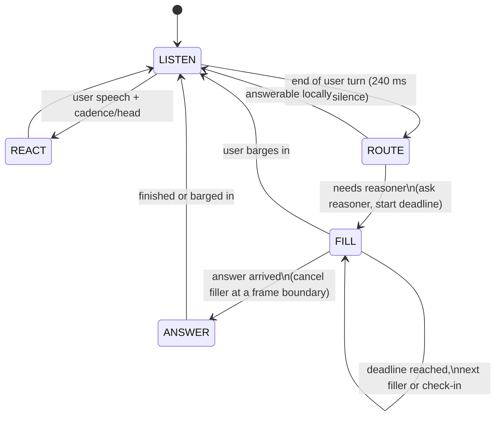

# Actor plan: duplex speech in front, big model thinking behind

The idea in one line: LFM3-Audio-2B is the **actor** — it listens, reacts, keeps the
conversation alive, and speaks whatever text it is handed. A **big text model** is the
**reasoner** — it is asked only when the turn needs thinking. The harness owns the
switch between them.

This file is a plan, not a claim. Every number below is either measured already or an
acceptance target to be measured.

## What is fixed by measurement (do not re-litigate)

| fact | evidence | consequence for this plan |
|---|---|---|
| the 2B does not ground content; its plans are generic, plan-swap gap ≈ 0 | earlier duplex experiments, adapter probes | the **answer** must come from the reasoner; the actor only voices it |
| forced text is spoken verbatim and intelligibly | product demo, today's forced-answer run | the handover mechanism is text injection, no new training needed |
| the actor's own sampled text is acknowledgement-level | today's demo, ASR of interjection stems | space-filling must be **scripted or forced**, not sampled free-form |
| generation runs ~7 frames/s on this GPU, 12.5 needed | profile: 74 ms LM + 75 ms sampling per 80 ms frame | live audio is impossible here; this plan is staged offline-first |
| `transcribe_live` exists but needs a live-ASR checkpoint; base Audio-2B is not one | model source | stage-3 realtime listening needs a different checkpoint, not a flag |
| energy VAD + rules give 160 ms barge-in and 240 ms take | stage-1 controller | keep the timing rules; they are the actor's reflexes |

## Roles

| piece | job | interface |
|---|---|---|
| `Actor` (LFM3-Audio-2B) | listen, react, fill, speak handed text | `listen(frame)`, `react()`, `fill(kind)`, `speak(text)`, `stop()` |
| `Router` | does this turn need the big model? | `needs_reasoning(turn_text, context) -> Decision(name, confidence)` |
| `Reasoner` (big LLM) | produce the answer text | `ask(question, context, deadline) -> str` (async) |
| `Session` | transcript, state, pending request, answer queue | one per conversation |
| `Orchestrator` | state machine + timing policy | drives the four above |

The "two manners" are **not** a trained mode switch. They are two driving modes of the
same weights: `react/fill` (sampled or forced short speech) and `speak` (forced text).
Making the model *decide* its own mode is an adapter-training project, and that line was
deliberately dropped; this plan does not require it.

## States



Timing policy:

| knob | target | why |
|---|---|---|
| silence before the first filler | ≤ 1.5 s | longer feels broken |
| single filler length | 1.5–3 s | short enough to cut cleanly |
| filler before check-in ("still working on it") | ≤ 8 s | longer sounds stuck |
| cancel-to-silence on answer arrival | ≤ 200 ms | seam audibility |
| cancel-to-silence on barge-in | ≤ 160 ms | already measured at stage 1 |
| reasoner deadline | 10 s, then check-in, 30 s hard fail | bounded promise to the user |

## Interfaces (concrete)

```python
class Decision(NamedTuple):
    name: str          # "local" | "reason"
    confidence: float

class Router(Protocol):
    def needs_reasoning(self, turn: str, context: list[str]) -> Decision: ...

class Reasoner(Protocol):
    async def ask(self, question: str, context: list[str], deadline_s: float) -> str: ...

class Actor(Protocol):
    def listen(self, frame: np.ndarray) -> None: ...      # 30 ms / 80 ms frames
    def react(self) -> str: ...                          # short speech, returns its text
    def fill(self, kind: str) -> str: ...                # scripted stall, returns its text
    def speak(self, text: str) -> None: ...              # verbatim, cancellable
    def stop(self) -> None: ...                          # 160 ms cancel
```

Text arriving from the reasoner is normalised before speaking: strip markdown, expand
abbreviations, cap at three sentences (ask again for a short version if longer), and
never read a list verbatim.

## Experiments before building the orchestrator

| # | question | method | gate |
|---|---|---|---|
| E1 | who can judge "needs reasoning"? | label 80 turns (fixtures + interview transcripts) `local` / `reason`; compare a keyword rule, a small text classifier, and the 2B's own label prompt | precision ≥ 0.80 at recall ≥ 0.70 |
| E2 | do scripted fillers sound like stalls, not answers? | 6–8 filler lines through the actor, ASR + end-energy + duration | intelligible, 1.5–3 s, no content claim |
| E3 | does verbatim handover survive? | speak three reasoner-style answers (2–3 sentences), measure ASR recall vs text, seam gap, no mid-word cut | word recall ≥ 0.95, seam ≤ 200 ms |
| E4 | does the timeline feel fluid? | offline renderer with a stub reasoner of configurable delay (2/5/10 s); measure max silence gap and fill coverage | max gap ≤ 1.5 s until the answer |
| E5 | is any of this realtime on the target? | frames/s and VRAM on the intended device class | ≥ 12.5 frames/s for live; otherwise label offline |
| E6 | can the 2B judge for itself? | same 80 turns, prompt "does this need careful reasoning? answer yes/no" | agreement ≥ E1; if not, the router stays outside |

E1 and E6 answer the open design question with numbers instead of intuition.

## Milestones

1. **M1 — offline actor timeline.** Orchestrator with a stub reasoner (fixed delay),
   actor = current `Lfm3` + the stage-1 rules, offline renderer. Gate: E3 + E4.
2. **M2 — real router.** Winner of E1 wired in. Gate: E1 on a held-out half of the 80
   turns, plus no regression in E4.
3. **M3 — real reasoner.** OpenAI-compatible endpoint (llama.cpp), timeout, check-in,
   failure text ("I couldn't get to that, ask me again?"). Gate: end-to-end with a real
   model on the meeting fixtures, E3 recall holds.
4. **M4 — device.** Only after a target is chosen: which model fits the power budget,
   which TTS voice, whether live ASR is a different checkpoint. Not started.

## Handover naturalness (the hard part)

No off-the-shelf model does "duplex speech plus a text answer injected mid-utterance".
The reason is structural, not a missing feature:

1. **A duplex speech model has no input text channel.** Models like Moshi/PersonaPlex
   emit their own text and audio jointly; text there is an output, and persona text is
   *conditioning*, not an answer channel. Injecting an answer means forcing tokens into
   the model's own text stream and letting the audio condition on them — which is
   teacher forcing, not a supported API.
2. **A TTS model has no conversation state.** It can read the answer beautifully, but it
   cannot be listening, reacting and barge-in-able at the same time; you get the duplex
   back only by running two voices side by side.
3. **Prosody is planned ahead.** Mid-utterance insertion lands inside a phrase whose
   intonation contour was already chosen, so the seam sounds like a splice even when the
   words and the voice are right.

Why LFM3-Audio-2B is still the best candidate here: it was trained on interleaved
text + audio (ChatML with speech blocks), so **a text block followed by speech is an
in-distribution pattern**. Forced text after the model's own `text_end` is exactly that
pattern, and it measured verbatim and seamless earlier in this project (harness lead +
fact in one utterance, ASR word-for-word). What is *not* in distribution is injecting
mid-block: at 0.5 s into a block the forced sentence lost its onset.

So the seam is a **boundary problem**, and it is measurable:

| path | how it works | naturalness risk | cost |
|---|---|---|---|
| **A. boundary handover** | filler ends at a phrase boundary / discourse cue ("…right, so —"), actor starts the answer text at its next block boundary | small gap (150–300 ms), no voice mismatch because the same model speaks both | none, measurable today |
| **B. learned handover** | train the actor on injection examples: filler audio → boundary → answer text → teacher audio continuation | the only path to seamless mid-phrase swaps | adapter data (~2k examples) + SFT |
| **C. TTS stitch** | answer rendered by a separate TTS in a matched voice, cross-faded | voice mismatch, two prosodic planners, no shared listening state | TTS service + voice matching |

Recommendation: prove A's seam numbers before paying for B, and treat C as the fallback
when a different voice is acceptable.

Naturalness proxies we can measure without listeners:

- **seam gap** between the last filler frame and the first answer frame (target ≤ 200 ms),
- **boundary type**: text-block boundary vs mid-block (the 0.5 s experiment says mid-block
  truncates),
- **truncation**: ASR recall of the answer text (target ≥ 0.95) and last-word energy,
- **double start**: the actor restarts a word at the seam (ASR duplicate-word rate),
- **F0 continuity**: median pitch step across the seam vs within a sentence,
- **filler suitability**: does the filler make a content claim (must be false), is it
  1.5–3 s.

| # | question | method | gate |
|---|---|---|---|
| E7 | does a block-boundary handover beat a mid-block one? | same answer text injected at the actor's `text_end` boundary vs 0.5 s into a block; blind-measured seam metrics | boundary: recall ≥ 0.95, gap ≤ 200 ms |
| E8 | does a cue phrase help? | filler ending with "…so, here's what I think" vs abrupt cut | cue reduces perceived gap (F0 step + gap), no truncated filler word |
| E9 | is learned handover needed? | build 2k injection examples from the 200 conversations, SFT, same seam metrics | only if E7/E8 miss the gates |

E9 is the "train the handover" path, and it is the only one that can learn prosodic
continuation. It should be entered with E7's numbers in hand, not before.

Out of scope for this plan: adapter training beyond E9, emotional modelling, multi-user
diarisation, and any claim of live audio on the current GPU.

## Open decisions

1. **Who judges** — harness router (recommended; the 2B's content judgement is its
   weakest measured skill) vs the 2B self-report (E6 measures it before discarding).
2. **Filler source** — scripted set (cheap, predictable, honest) vs actor-sampled
   (natural prosody, generic content) vs both (sampled when the router is unsure).
3. **Handover at word level** — finish the current filler phrase, or cut at the next
   frame boundary. Both are measurable in E3; the default is to cut at a boundary.
4. **Answer length contract** — the reasoner must return speech-sized text. Decide the
   cap (3 sentences) and whether the orchestator asks for a short retry.
