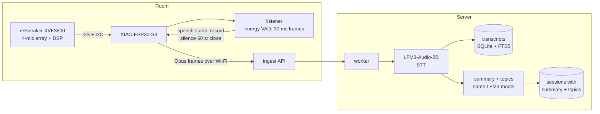

# Architecture

## Goal

Turn spoken conversations in a room into a queryable event knowledge base:
what was discussed, what was decided, who owns the follow-up.

## Components



The device listens, records, and ships audio. The server transcribes with
LFM3-Audio-2B and writes the summary with the same loaded model. The structured
event contract further down is **future work**: it needs a larger language model,
because the 2B failed it in measurement (`knowledge-base.md`). The listener is implemented
in `app/listener.py` and runs on the host as well as on the device; the firmware
portion is still planned (see device.md).

## Contracts

### Device to server

One chunk per 60 s of speech, Opus in a WAV/Ogg container, named:

```
rep01-20261107-143012-s003.opus
└────┬────┘ └─────┬──────┘ └─┬─┘
  device       session     chunk
```

- `POST /ingest`, `X-Filename` carries the name.
- Raw body is the audio file.
- `Authorization: Bearer <token>` when `REPARTEE_INGEST_TOKEN` is set.
- Response `200` means stored; anything else means retry later.
- Idempotent on filename: re-uploading the same chunk returns `duplicate`.

### Server to knowledge base

Transcripts are appended to a session as chunks arrive. When the session ends
(sentinel upload or 5 minutes without a new chunk), the extractor runs once over
the whole transcript and writes structured events.

## Server pipeline (built)

```
data/spool/      uploaded chunks land here (.part then atomic rename)
data/working/    claimed by the worker
data/done/       transcribed, audio kept for reference
data/failed/     quarantined with a .error sidecar
data/repartee.db SQLite, conversations table + FTS5 index
```

`app/server.py` exposes `POST /ingest`, `GET /health`, `GET /conversations`,
`GET /conversations/{id}`, `GET /search`, `GET /api/days`, `GET /api/sessions`,
`GET /api/sessions/{id}`, `GET /api/stats`. `app/pipeline.py` claims files, runs ASR,
writes the transcript and summary as one row, and moves the file.

## Web UI

`GET /` serves a dashboard bound to `0.0.0.0` so anyone on the LAN can open
`http://<host>:8080/`.

- `GET /api/days` - calendar days with conversation count and total audio seconds
- `GET /api/sessions?day=YYYY-MM-DD` - that day's conversations, or the latest 200
- `GET /api/sessions/{id}` - one conversation: transcript, summary, metadata
- `GET /api/stats` - session and day counts

The front end is `app/web/` (HTML, CSS, one dependency-free JS file): sidebar of
days, conversation cards for the selected day, detail panel with the summary and
the transcript, and a transcript search box. A session is deep-linkable with
`/#s=<session id>`. There is no authentication on the UI -
it is a read-only LAN surface for now.

Grouping is by calendar day: the first ten characters of the session's start
timestamp (`YYYY-MM-DD`), so every conversation is filed under the day it started.
The timestamp itself comes from the upload filename:

```
20261107-143012-room1.opus
└──┬───┘ └──┬─┘ └─┬─┘
  date    time  device
```

Clock source matters: the device stamps the filename from its own clock, so it must
sync via SNTP before uploading. A device that boots offline would file audio under
the wrong day. The server should also record its own receive time as a fallback.

Crash recovery: anything left in `working/` is requeued on startup; `.part` files
are deleted.

## Knowledge-base stage (planned)

```
transcript
  → chunk by time and speaker turns (5-10 min windows)
  → extract per chunk with Qwen3.5-9B, JSON only, temperature 0
  → validate against schema, retry once on failure
  → merge and dedupe (same decision stated twice becomes one event)
  → resolve people and projects against existing entities
  → store
```

Proposed shape:

```json
{
  "decisions": [{"text": "...", "rationale": "...", "owner": null,
                 "evidence": "verbatim quote", "t": 412.5}],
  "actions":   [{"task": "...", "owner": "name or null",
                 "due": "date or null", "evidence": "quote"}],
  "topics": ["..."],
  "open_questions": ["..."],
  "attendees": [{"name": null, "speaking_time_s": 41.2}]
}
```

Rules that keep a 9B model honest:

- every decision and action carries a verbatim `evidence` quote
- `null` and `"none"` are legal answers; do not force a value
- validate JSON; retry once with the error appended
- grammar-constrained decoding so malformed JSON is impossible

## Decisions

| Decision | Why |
|---|---|
| Device records, server transcribes | the device has no GPU; ASR needs one |
| 60 s chunks, not whole meetings | ASR memory and compute blow up on long audio (see asr-notes) |
| Chunk boundary at a pause | a cut mid-word corrupts the first word of every chunk |
| Opus, not WAV | 10x smaller upload, better RAM use on a card-less device |
| Session grouping on the server | 60 chunks must become one conversation, not 60 |
| Extract per chunk, merge after | a 9B loses the middle of a long input and costs more |

## Open questions

1. Does the 9B run on the GPU sequentially after ASR, or on CPU in parallel?
2. Which ASR becomes the default: 1.7B for accuracy or 0.6B for headroom?
3. Speaker labels: skip, or add the forced aligner plus a diariser?
