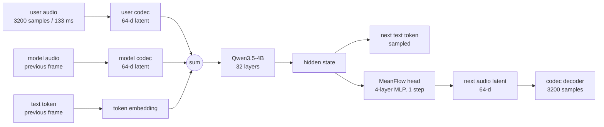

# Vani: full duplex with text injected at any time (Haru-4B base)

Requirement: the model listens and speaks at the same time, and **text can be handed to
it at any moment** — while the user speaks, while the model speaks, or while the model
is only listening — and it speaks that text out.

Haru-4B is the model in the blog (`blog.higurashi.ai/melte/haru4b`, released 2026-11-13,
Apache-2.0, code at `github.com/higurashi-ai/Haru`). It is native full duplex, and,
unlike Moshi/PersonaPlex-style models whose text stream is only an output, its text
stream is **an input to the language model on every frame**. That is the injection
channel. No retraining, no TTS, no turn boundary.

## 1. How Haru does full duplex

One language-model position is one 133 ms frame (7.5 Hz). Three streams are embedded
and **summed** into that position:



- Audio is **continuous**, not discrete codes: one 64-d latent per frame, from/to 24 kHz
  through the causal VibeVoice codec.
- The audio head is a small MLP trained with flow matching then distilled with MeanFlow,
  so each latent is produced in **one sampling step** from the LM hidden state.
- Text is **chunk-level**: text tokens occupy frames, frames without text carry a PAD
  token, and an **EOP** token marks the frame before speech starts. The `StreamDetokenizer`
  renders a run of PAD/EOP as a single space, i.e. the model speaks with gaps between
  text chunks. There is no end-of-speech token (EOS is banned from sampling); the model
  stops by returning to PAD.
- Because the streams are summed rather than interleaved, listening and speaking never
  wait for each other, and the context is not three times longer.

The blog's latency budget is 65 ms end to end on an M1 Max (5.3 ms input, 34.2 ms model
step, 4.1 ms handoff, 13.3 ms output wait, 8.1 ms output), plus up to 133 ms of framing;
about 15 ms per step on a B300 through vLLM-Omni.

### How the stream was trained to make forcing safe

Two pretraining stages on >40M hours of real speech (160+ languages, no LLM- or
TTS-generated dialogue): single-channel ASR + speech/text continuation + text rehearsal
on Qwen3.5-4B, then full-duplex training on >13M hours of two-speaker conversations
separated from single-channel recordings with FastDialogueSidon, with samples up to 60
minutes. Character cards condition persona, a short reference clip conditions voice.

The point for injection: the LM was trained with the **ground-truth text stream as an
input on every frame**, aligned at chunk level to the audio it predicts. Forcing a token
is therefore teacher forcing of a channel the model already expects, not a new input
modality.

## 2. Why text injection is a sampler override

At frame `t` the LM consumes `text[t] + model_audio[t] + user_audio[t]` and predicts
`text[t+1]` and `model_audio[t+1]`. The served `DuplexSession` **samples** `text[t+1]`
from the logits. Injection replaces that sample with the next token of the injected
sentence:

```
frame:        k          k+1            k+2
text out:     EOP        " The"         " Har"
text in:      EOP        " The"         " Har"      <- consumed one frame later
audio out:    old plan   speech onset   audio "The"
              ^ first forced token emitted here
```

`text out` is what the sampler emits (forced), `text in` what the LM consumes at
that position. The first forced token is `EOP` when the model was silent,
otherwise the first word token.

Consequences, all structural:

- **One frame of lead, two from silence.** A forced token emitted at frame `k` is
  consumed at `k+1`, and the audio predicted at `k+1` follows it; the audio already
  emitted at `k` belongs to the old plan. Mid-utterance, injection-to-audio is therefore
  133 ms. From silence the EOP takes one frame, so the first word's audio is at `k+2`
  (266 ms), and `k+1` carries the speech onset. The one-frame seam is the only place the
  old and new plans meet.
- **No turn boundary.** The KV cache is never reset and the prompt is never re-run. This
  is exactly what LFM3 could not do: there, a turn held one utterance and a second
  sentence produced no audio (`seam-results.md`). Haru has no per-turn EOS to suppress,
  so a sentence can start at any frame.
- **Cancellation is the same operation.** Clearing the queue and putting PADs on the
  stream makes the model silent. The server has no utterance-level interrupt or
  truncate endpoint (the one `/api/webrtc/cancel` closes the whole session for the
  transport fallback), but none is needed for barge-in: the forced stream is the cut.
  Audio already sent to the transport is cut there.
- **The forced text becomes history.** It is in the model's text stream, so the model
  answers follow-ups with knowledge of what it was told; nothing is re-fed as a fake
  assistant turn (the failure that leaked the cue in `seam-results.md`).

## 3. Who controls what

The injected text controls **words**, not acoustics. The model still renders them, and it
is still listening. The split is:

| what | controlled by | how |
|---|---|---|
| the words spoken | **you** (hardcoded text) | forced text token on each frame; the sampler is bypassed |
| when speech starts and stops | **you** | `EOP` to start, PAD frames to stop; the queue is the script |
| interruption | **you** | clear the queue; force PAD; the next injection starts at the next frame |
| voice, timbre | reference clip + character card | conditioning, unchanged by injection |
| prosody, stress, micro-timing | the model | hidden state → MeanFlow head; it renders *your* tokens |
| listening | the user audio stream | always on; the LM consumes it every frame |
| backchannels, breaths, laughs | the model (unless scripted) | audio head can emit non-lexical sound no text token asked for |
| free word choice | the model, **only when the queue is empty** | normal sampling resumes unless `scripted=True` |

Two modes follow from the last two rows:

- **Scripted (`scripted=True`)** — every frame is either a queued token or PAD. The model
  never free-samples a word, so the lexical output is exactly your script. It still
  listens, still speaks over the user, still uses the reference voice; it loses the text
  stream's backchannels and spontaneous reactions, though non-lexical audio may still
  appear (see the non-guarantees below). This is the "hardcoded text" mode.
- **Hybrid** — injected spans are forced; between them the model free-samples
  acknowledgements and reactions. Control is local to the injected sentence, not global.

Guarantees and non-guarantees in scripted mode:

- **Guaranteed:** the model's text stream is exactly the queued token ids; no other word
  is sampled. With a fixed seed, a render is reproducible.
- **Not guaranteed:** the vocoder's pronunciation of an unusual token, and the absence of
  non-lexical noise. The text stream specifies words, not phonemes. Hence the ASR gate:
  the expected string is known exactly, so the check is a word diff, and a failed phrase
  is re-injected (the model cannot refuse text, but it can mispronounce).
- **Not controlled**: prosody and the seam. An injected sentence lands in a prosodic plan
  the model already started; that is what the seam metrics in §7 measure.

What "hardcoded" buys: no reasoner, no routing, no LLM latency, and an exact expected
string to verify against. What it does not buy: a way to make the model *not* hear the
user, or a way to make mid-word pivots sound planned.

```
session = InjectedSession(model, card, voice, cfg, scripted=True)
session.start()                                   # frame 0, PAD, listening
session.inject("Good morning. The review is on Tuesday at nine.")   # at any frame
# after the queue drains the stream holds PAD: the model's silence state, still listening
```

PAD is the model's "not speaking" frame; the residual audio is its room tone, not words.
Scripted mode therefore gives you the script and the silence, not a mute button: the
audio head still runs every frame.

`inject()` while the model is speaking clears the unspoken remainder (one queue) and
starts the new sentence at the next frame; the already-spoken words stay in the model's
context, so later free speech (hybrid mode) knows what was said.

**Walkthrough — a hardcoded announcement while the user is talking.**

1. Frames before `k`: scripted PAD; the model is silent but consumes every user frame.
2. Frame `k`: `inject("Attention: the building closes at six.")`. The model was silent, so
   EOP goes on frame `k`, the first word on `k+1`, its audio at `k+2`. The user stream is
   untouched: the announcement starts *over* the user's speech.
3. Frame `k+N`: the queue is empty and PAD resumes. Scripted mode stays silent; hybrid
   mode may react.
4. The user asks "sorry, what?": in scripted mode the model still cannot answer — you
   inject the answer. In hybrid mode it may answer on its own, and its context already
   contains the announcement, so it knows what it said.
5. A second announcement arrives mid-announcement: `inject(..., interrupt=True)` clears
   the unspoken remainder. The word already emitted at the seam is one frame of old
   audio; everything after it follows the new text.

While the queue is non-empty the model cannot insert a word of its own: the sampler is
bypassed on every frame. That is the whole control guarantee.

## 4. The schedule

The scheduler is `vani/inject.py`; it builds a list of token ids, one per frame. Three
rules matter, and each comes from the trained stream rather than taste:

1. **Dense tokens, no gaps.** One token per frame, with no PADs between words. This was
   measured: with `gap=1` the model spoke only the first phrase ("Light from the sun")
   and stopped, while `gap=0` rendered "Light from the sun takes about eight minutes to
   reach Earth." word-for-word (Qwen3-ASR 1.7B). Haru's audio head treats a PAD in forced
   text as a stop, not as a word space. `gap` remains a knob for deliberately slower
   delivery, but the default is 0.
2. **EOP only when starting from silence.** `lead_eop=None` inserts EOP iff the last
   emitted token was PAD. Mid-utterance injection must not insert EOP, which would read
   as a new speech onset.
3. **Tail PAD** closes the injected utterance instead of letting the model's old
   continuation resume mid-sentence.

Example, `"The Harrow project."` (tokens: `The`, ` Har`, `row`, ` project`, `.`):

```
EOP | The | Har | row | project | .
```

The frame rate fixes the upper bound: 7.5 tokens/s. Dense text is ~3–4 words/s for
normal English, so it matches speech without artificial gaps.

## 5. Reference implementation

```python
class TextInjector:                      # vani/inject.py, lock-protected
    def speak(text, wait=False, interrupt=True, gap=1, ...) -> list[int]:
        ...                              # tokenize, EOP/word gaps, queue or defer
    def poll() -> int | None:            # once per frame, before sampling
        ...                              # forced token, or None to let the model choose
    def observe(token):                  # after every frame
        ...                              # PAD-run counter for idle detection

class VaniSession(DuplexSession):    # vani/session.py
    def inject(text, **kw):
        return self.injector.speak(text, **kw)
    def _emit(self, hidden, started):
        forced = self.injector.poll()
        if forced is None and self.scripted:
            forced = self.pad_id         # script mode: never free-sample a word
        if forced is not None:
            ...decode audio from hidden, update DRY, detokenize...
        else:
            ...parent path: the model samples its own token...
        self.injector.observe(token)
```

`speak()` may be called from a background thread while the audio loop calls
`poll()`/`observe()`; the lock serialises the queue. The model step itself stays
single-threaded.

`vani/session.py` runs five scenarios on a checkpoint: `baseline_own_speech`
(cadence), `listen_inject` (silent model), `speak_inject` (mid-utterance pivot),
`user_talking_inject` (user speaking → overlap), `scripted_control` (hardcoded text,
PAD whenever idle). It writes the model channel, the user
channel, a stereo mix, per-frame tokens/text, and ASR recall of the injected sentence
(word-level LCS against Qwen3-ASR).

```bash
# needs the 10.5 GB checkpoint and ~12 GB of GPU; CPU is offline-only
.venv/bin/python vani/session.py --model /path/to/Haru-4B --device cpu \
    --dtype float32 --out data/haru_inject
```

The structural path was exercised with a tiny randomly-initialised Haru (same code,
small config): the forced tokens appear in the frame stream in schedule order and audio
decodes for every frame. That proves the wiring, not the speech; word fidelity needs the
real checkpoint.

## 6. Product interface

The injection primitive turns the actor/reasoner split of `actor-plan.md` into a text
queue in front of one model:

```python
speak(text, mode="now" | "when_idle", interrupt=True)
```

| mode | behaviour |
|---|---|
| `now` | next frame takes the first token; if the model is speaking, this is the pivot/barge-in |
| `when_idle` (`wait=True`) | hold until the model is idle (a run of PAD frames, not one), then EOP + words |
| `interrupt=False` | append behind the current sentence; do not cut it |

**The requested behaviour is the default, `scripted=False`:** audio drives the model as
usual (native full duplex, its own replies and backchannels), and a background
`inject(text)` preempts the text stream only for the frames of that sentence. The model
still consumes user audio on those frames, still renders in the reference voice, and
treats the injected line as something it said — after the queue drains, normal sampling
resumes. `wait=True` is the polite variant: say it at the next pause instead of cutting.

A single PAD frame is not silence: the model also puts PAD between words. "Idle" is
therefore a run of PAD frames (`idle_frames`, default 4 ≈ 0.5 s), and an automatic EOP is
inserted only from idle, never at a word gap. This keeps `wait=True` from starting a new
utterance in the middle of the current one.

This is not a TTS switch. Nothing is re-prefilled and the cache is not reset; the model
never leaves full-duplex operation. The only thing that changes is who supplies the text
token on the frames of the injected sentence.

One queue, so a new `now` injection drops the unspoken remainder of the old one (the
model cannot say two texts at once). Priority is by policy, not by model: a safety
notice uses `now`; a long answer uses `when_idle`; a correction uses `now,
interrupt=True`.

The text source is outside the model and interchangeable: a hardcoded line, a template,
a rule, or a big reasoner all call the same `speak`. Session flag `scripted=True` closes
the free-speech path, so the script is the only lexical source; without it the model
keeps talking in the gaps. The reference harness implements all three: `now` is the
default, `when_idle` is `wait=True` (activated from `model_idle`, a PAD run), and
`scripted` is the session flag.

Verification is a scheduler concern: ASR the injected span and re-inject on low recall.
The model does not expose confidence for forced tokens. With hardcoded text the expected
string is known, so the check is exact (word diff), not semantic.

## 7. What to measure before trusting it

The gates are the ones this project already uses (`seam-results.md`), applied to the
duplex stream:

| measure | gate | why |
|---|---|---|
| ASR word recall of the injected sentence | ≥ 0.95 | forced text must be rendered, not just consumed |
| onset: injection frame → first speech frame | report (expected 2 frames + onset) | the product's latency promise |
| old-plan residue: words from the model's continuation before the seam | ≤ 1 word | a pivot that finishes its old clause is not a pivot |
| duplicate/truncated word at the seam | 0 | the LFM3 failure mode |
| F0 step across the seam vs within-sentence | ≤ within-sentence median | audible-splice proxy |
| user overlap: model speech while user audio is voiced | present, user ASR still correct | full duplex is not half-duplex |
| tokens/s and PAD runs of the model's own speech | baseline for `gap` | pacing calibration |

No number is claimed here: the checkpoint was not run on this 8 GB box. It needs ~12 GB
of GPU for the PyTorch implementation; the blog's 65 ms is Apple Silicon with custom
Metal kernels, and 15 ms/step is a B300.

## 8. What was measured

On the 8 GB Quadro RTX 4000, bf16 CPU reference (the GPU cannot hold bf16):

| build | audio of a forced sentence | notes |
|---|---|---|
| **bf16, dense (`gap=0`)** | ASR: "Light from the sun takes about eight minutes to reach Earth." | **word-for-word**; this is the working path |
| bf16, `gap=1` | ASR: "Light from the sun." then silence | PAD between words stops the audio head |
| bf16, **normal mode from silence** | ASR: "Hello." | **works**: injecting while neither side talks starts speech |
| bf16, scripted from silence | RMS 0.0: no speech | scripted mode forces PAD; EOP + text does not start the vocoder from that forced-silent state |
| **4-bit NF4 LM + bf16 audio** | ASR: "I don't know. Do I?" | quantized LM text stream was exact, audio was not; 4-bit fails this quality gate |

So the mechanism works with dense tokens in normal (hybrid) mode, including when nobody is
talking: the model's own room-tone audio is context enough. The failure was specific to
`scripted=True`, which forces PAD and suppresses speech initiation. 4-bit is not usable
for audio fidelity; bf16 is the reference.

## 9. Limits

- **Prosody is not re-planned.** The word embeddings are teacher-forced into the LM; the
  model speaks them, but the intonation of the next frames was planned before the
  injection. A mid-word pivot can sound spliced. TurnGuide-style training (turn-level
  text/speech interleaving) is the way to make the transition in-distribution if the
  seam is audible.
- **The base model does not ground facts.** Injected text must come from the reasoner;
  the model is the voice and the timing, exactly as `actor-plan.md` says.
- **One conversation per process** in the reference server; production needs the
  vLLM-Omni plugin or a session pool.
- **Voice rights**: the reference clip sets the voice; use only clips you may use.
- The 4B is a research base model; no instruction-following guarantee beyond the
  character card.
