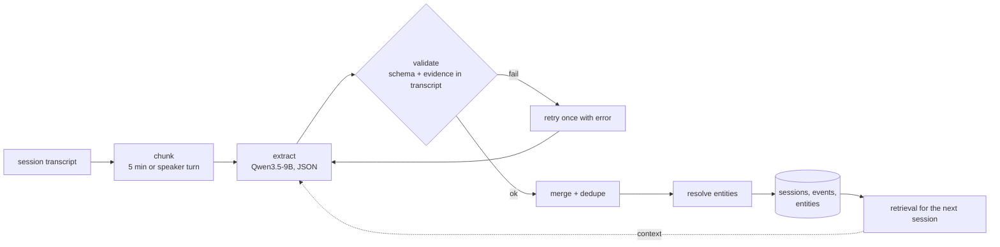

# Knowledge base (planned)

The 9B stage: turn a transcript into structured events that can be queried,
linked and reasoned over later.

This work does **not** need the room mic. It consumes text, so it can be built
and evaluated on written transcripts today.

## What is an "event"

An **event** is an atomic, checkable statement extracted from a conversation:

| kind | example | required fields |
|---|---|---|
| `decision` | "we will delay the launch to Q2" | text, evidence, t |
| `action` | "Raki will send the spec by Friday" | text, owner, due, evidence |
| `question` | "do we still need the second vendor?" | text, evidence |
| `topic` | "pricing for the enterprise tier" | text, t |

A **session** is one meeting or conversation. Events belong to exactly one
session. Entities (people, projects, products) are shared across sessions and are
what make the base a *knowledge* base rather than a pile of summaries.

## Schema

```sql
CREATE TABLE sessions (
    id           TEXT PRIMARY KEY,      -- rep01-20261107-143012
    device       TEXT NOT NULL,
    started_at   TEXT,
    ended_at     TEXT,
    duration_s   REAL,
    language     TEXT,
    transcript   TEXT NOT NULL,
    status       TEXT NOT NULL          -- receiving | extracting | ready | failed
);

CREATE TABLE events (
    id           TEXT PRIMARY KEY,      -- session + seq
    session_id   TEXT NOT NULL REFERENCES sessions(id),
    kind         TEXT NOT NULL,         -- decision | action | question | topic
    text         TEXT NOT NULL,
    evidence     TEXT NOT NULL,         -- verbatim quote from the transcript
    t_start      REAL,                  -- seconds into the session
    confidence   REAL,
    created_at   TEXT NOT NULL
);

CREATE TABLE entities (
    id           TEXT PRIMARY KEY,
    kind         TEXT NOT NULL,         -- person | project | product | org
    name         TEXT NOT NULL,
    aliases      TEXT                   -- JSON array
);

CREATE TABLE event_entities (
    event_id     TEXT NOT NULL REFERENCES events(id),
    entity_id    TEXT NOT NULL REFERENCES entities(id),
    role         TEXT NOT NULL          -- owner | subject | mentioned
);

CREATE TABLE event_links (
    from_event   TEXT NOT NULL REFERENCES events(id),
    to_event     TEXT NOT NULL REFERENCES events(id),
    relation     TEXT NOT NULL          -- supersedes | follows_up | duplicates
);
```

`evidence` is not optional. It is the anti-hallucination mechanism: an event whose
quote is not literally in the transcript is rejected.

## Pipeline



Chunking matters even with a 262k context: a 9B loses the middle of long inputs,
and per-chunk extraction yields timestamps for free.

## Extraction contract

Prompt rules:

- Return JSON only, matching the schema. No prose, no markdown fence.
- Every decision and action must include `evidence`: an exact substring of the
  input. If no such sentence exists, do not emit the event.
- `null` is a valid owner or due date. Never guess.
- Ignore small talk; do not invent rationale that was not spoken.
- If the chunk contains nothing worth extracting, return empty arrays.

Decoding: grammar-constrained JSON (llama.cpp `json_schema` / GBNF) so malformed
output is impossible. Temperature 0.

Validation after generation, as implemented in `app/extract.py`:

1. parse JSON (tolerating a markdown fence or leading prose)
2. `evidence` must exist in the chunk: exact match, or 90 % of its words in order
3. `owner` must appear literally inside the quoted `evidence`, otherwise it is
   set to `null` - coreference ("do it", "I will") is not accepted as proof
4. same-kind events whose evidence overlaps, or (for decisions) sits within 40
   characters, merge into one event
5. a response that ended because of the token limit is retried once with a
   larger budget instead of discarding the chunk

Measured on the three fixtures with Qwen3.5-9B IQ4_XS: zero ungrounded events,
owners correct where named, empty arrays on the no-outcome transcript.

## Model and runtime

| Model | Quant | Weights | KV @ 8k | Fits with 0.6B ASR? |
|---|---|---|---|---|
| Qwen3.5-9B | IQ4_XS | 5.17 GB | ~0.26 GB | ~7.0 GB, yes |
| Qwen3.5-9B | Q4_K_M | 5.68 GB | ~0.26 GB | ~7.5 GB, tight |
| Qwen3.5-9B | Q3_K_M | 4.67 GB | ~0.26 GB | ~6.5 GB, comfortable |
| Qwen3.5-4B | Q4_K_M | ~2.6 GB | ~0.1 GB | yes, with room |

KV math: 8 full-attention layers x 4 KV heads x 256 head_dim x 2 (K,V) x 2 bytes
= 32 KB per token; 8k tokens ≈ 0.26 GB. The other 24 layers are linear attention
and hold constant state.

Serve with `llama-server` (OpenAI-compatible `/v1/chat/completions`), `-ngl 99`,
`--ctx-size 8192`. Keep ASR and the LLM in separate services so either can be
restarted or moved to CPU independently.

Fallback if VRAM is short: run the LLM on CPU. 12 cores, 62 GB RAM, 9B Q4 -
roughly 5-10 minutes per session, acceptable for a batch pipeline.

## Evaluation

The KB stage can be tested without audio. Build a fixture set of written meeting
transcripts where the expected output is known:

- 5 transcripts, 10-40 min each, covering: a decision-heavy meeting, a
  status update with no decisions, a meeting with an ambiguous owner, a
  transcript full of chatter and no outcomes, one with a decision that is later
  reversed.

**Fixtures must look like ASR output, not a screenplay.** The transcription model
produces one continuous paragraph with punctuation: no speaker labels, no turn
boundaries, no timestamps, and no names except those spoken out loud. Fixtures
written as `Raki: ... / Tom: ...` test a format that will never occur.

Consequences that follow from this:

- `owner` is `null` unless a name is spoken near the action ("Sam, can you own
  the staging plan?" -> owner Sam; "I'll chase the audit logs" -> `null`).
- The extractor must not assume who is speaking, and must not invent an owner.
- Fillers ("um", "yeah") and repetitions are part of the input and must be
  tolerated.

Current fixtures:

| File | Purpose |
|---|---|
| `meeting_01.txt` | decision-heavy; two owned actions; one open question |
| `meeting_02.txt` | no decisions, no actions; must return empty arrays |
| `meeting_03.txt` | decision reversal; one owned action, two unowned |

Metrics per kind: precision, recall, and **hallucination rate** (events whose
evidence is not in the transcript). Target: recall >= 0.8 on decisions, 0
hallucinations.

The fixtures are also how the 4B vs 9B and the quant comparisons get settled -
same inputs, same expected output.

## Milestones

| # | Deliverable | Acceptance |
|---|---|---|
| 1 | Schema + storage (`app/kb.py`) | create tables, insert a hand-written event, query it back |
| 2 | Extractor (`app/extract.py`) against llama.cpp | one transcript -> valid JSON, evidence verified |
| 3 | Chunker + merge | a 30-min transcript produces one merged event list, no duplicates |
| 4 | Fixture set + eval harness | precision/recall/hallucination numbers on 5 fixtures |
| 5 | Entity resolution | "Raki" and "Raki Delmoro" collapse to one entity |
| 6 | Cross-session retrieval | a later session can reference an earlier decision |

Milestones 1-4 need no GPU tuning and no room mic. Start there.

## Risks

| Risk | Mitigation |
|---|---|
| Model invents a decision | evidence must appear in the transcript; reject otherwise |
| Model misses items in long input | chunk at 5 min; merge |
| JSON drift | grammar-constrained decoding |
| VRAM contention with ASR | separate processes; LLM to CPU if needed |
| "Who decided" is unknowable | one beamformed channel has no speaker labels; store `owner: null` rather than guessing |
| Duplicate events across chunks | merge on normalised text + time proximity |

## Open questions

1. Is a session the right unit, or should events span meetings on the same topic?
2. Do we need speaker labels before extraction, or is `owner: null` acceptable
   for the first version?
3. Where does the "current state of a project" live - derived on read, or
   maintained as a materialised summary per entity?
