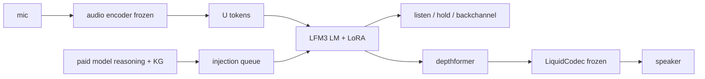

# Architecture

## Base

- **LFM3-Audio-2B**, 2B parameters, 32K context.
- Frozen: audio encoder, audio projector, LiquidCodec; audio depth decoder optional LoRA.
- Trained: LoRA on the 24-layer LM, plus small control/output rows.
- Audio format: 24 kHz output, 12.5 frames/s, 12 codebooks per 80 ms frame.
- Interleaved text: 6 text slots then 12 speech frames per block.

## Stream layout

Duplex is one pair per 80 ms:

```
[U_t][A_t] [U_t+1][A_t+1] ...
```

- `U_t` — user audio token from the frozen encoder.
- `A_t` — an audio frame. Silence frames mean listening; short speech frames are backchannels. No control tokens, no text in duplex.
- Loss on `A` only. `U` is context.

Injection enters the same `A` slot:

```
[U][A] ... [U][text tokens][<text_end>][injected speech frames] ...
```

The user stream keeps flowing while Vani speaks the injected clause.

## Voice

The product voice is the TTS teacher voice. Open Yap agent audio is re-voiced
with that teacher and time-aligned to the original turns, so backchannels,
fillers, and injected answers share one voice.

## Runtime



- The paid model and knowledge base are outside the 8 GB box.
- The judge ASR is evaluation-only; runtime transcription uses LFM3 itself.

## Constraints

- 32K context at ~25 tokens/s (U + A) ≈ 20 minutes; sliding window required.
- 8 GB local card fits 5 s training windows at 5.4 GB; full-corpus training needs
  a rented 24–48 GB GPU.
- 20 ms control / 80 ms encoder / 160 ms LM is the target clock; measured
  generation is below real time on the local card.
